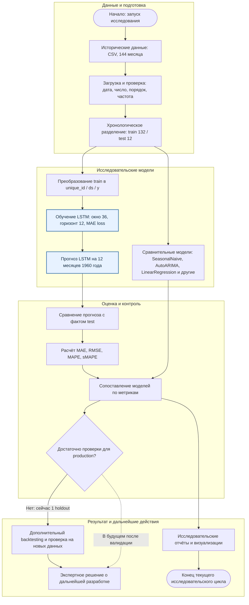

# Роль LSTM в процессе прогнозирования временного ряда

**Проект:** [`project_neto_time_completion`](https://github.com/AndreyBers/project_neto_time_completion)
**Основная модель схемы:** LSTM (`neuralforecast`)
**Тип процесса:** технический, **offline-эксперимент** с прогнозированием месячного пассажиропотока и сравнением моделей.
**Статус:** экспериментальная оценка, без подключения LSTM к производственному API или автоматическим бизнес-решениям.

## 1. Схема процесса (Mermaid, BPMN-подобная)

Диаграмма построена как поток задач с развилками и группировкой по участникам процесса. GitHub отображает её непосредственно в Markdown; отдельный PNG/JPEG не требуется.

**Как читать схему.** На вход поступают архивные данные. Они проверяются и делятся по времени; тестовый 1960 год остаётся неизвестным для модели на этапе обучения. LSTM получает только тренировочную историю, строит прогноз на год, после чего прогноз сравнивается с фактом и прогнозами конкурирующих моделей. Метрики и визуализации помогают аналитику выбрать направление доработки. **Переход к production на текущем этапе не подтверждён:** сначала требуется более широкая временная проверка.

## 2. Какую задачу модель решает в процессе

LSTM отвечает за **прогнозирование непрерывной числовой величины** - месячного международного пассажиропотока на следующие 12 месяцев. В конкретном эксперименте модель обучается на январе 1949 - декабре 1959 года и прогнозирует январь - декабрь 1960 года.

В техническом процессе её задача - превратить исторический временной ряд в проверяемый числовой прогноз и предоставить результат для количественного сопоставления с альтернативами.

## 3. Почему здесь целесообразен ML

Ряд содержит **восходящий тренд, повторяющуюся годовую сезонность и изменение амплитуды колебаний**. Простое повторение последнего значения не позволяет полноценно учитывать такие зависимости.

LSTM способна извлекать закономерности из последовательности прошлых наблюдений без ручного задания всех правил. Это обосновывает её включение в исследование наряду со статистическими методами и классическим ML. При этом **применение нейросети не является обязательным**: в эксперименте линейная регрессия показала близкое качество и вычислительно проще. Поэтому выбор модели должен опираться на сравнение метрик, скорости и устойчивости, а не только на сложность архитектуры.

## 4. Какие данные поступают на вход модели

| Этап | Данные |
| --- | --- |
| Источник | `data/raw/international-airline-passengers.csv` |
| Исходная структура | `Month` - месяц, `Count` - пассажиропоток (в тысячах пассажиров) |
| Полный ряд | 144 месячных наблюдения, январь 1949 - декабрь 1960 |
| Обучающая часть | 132 месяца, январь 1949 - декабрь 1959 |
| Формат для `NeuralForecast` | `unique_id`, `ds`, `y` |
| Входное окно LSTM | 36 предыдущих месяцев (`input_size=36`) |
| Горизонт | 12 будущих месяцев (`h=12`) |
| Проверочная часть | Последние 12 месяцев 1960 года, используются **после** прогнозирования для оценки |

Первичная загрузка и разбиение реализованы в `src/time_series_project/data.py`. Исследовательский ноутбук использует `to_nixtla_df()` и обучает `LSTM(h=12, input_size=36, loss=MAE(), max_steps=100, random_seed=42)`.

**Дополнительная ветка качества данных:** в проекте отдельно исследуются аномалии (rolling z-score, STL residual, IsolationForest) в `notebook/05_anomaly_detection.ipynb`. Это аналитическая проверка, а не обязательный автоматический этап удаления наблюдений перед LSTM; схема намеренно не приписывает модели несуществующую очистку аномалий.

## 5. Куда поступает и как используется результат

**Выход LSTM** - 12 строк с датой и прогнозируемым значением `LSTM` в тысячах пассажиров. Результат применяется следующим образом:

1. Для каждого месяца прогноза берётся соответствующее **реальное** значение из отложенного тестового года.
2. Рассчитываются **MAE, RMSE, MAPE и sMAPE**; итоговые метрики DL-моделей записываются в `reports/neuralforecast_comparison.csv`.
3. LSTM сопоставляется с базовыми, статистическими и классическими ML-моделями. Сохранённый результат LSTM: **MAE 16,03; RMSE 18,01; MAPE 3,37 %; sMAPE 3,37 %** на 12 месяцах 1960 года.
4. Аналитик изучает метрики и графики, фиксирует ограничения и решает, какие эксперименты провести дальше. В текущем проекте следующий обоснованный этап - **rolling backtesting**, оценка разброса качества и проверка на новых данных.

Никаких заявлений о реально запущенном планировании авиаперевозок, автоматически принимаемых бизнес-решениях или подключённой пользовательской системе проект не содержит.

## 6. Разделение исследовательского и исполняемого контуров

Чтобы не смешивать разные части проекта:

| Контур | Реальная реализация | Что выдаёт |
| --- | --- | --- |
| **Исследовательский (LSTM)** | `notebook/04_neuralforecast_dl_models.ipynb` | Прогноз LSTM, графики, метрики в `reports/neuralforecast_comparison.csv` |
| **Исполняемый CLI (baseline)** | `src/time_series_project/pipeline.py` и `cli.py` | Прогнозы `Naive`, `SeasonalNaive`, `Drift`; файлы `reports/final_pipeline_results.csv`, `reports/baseline_predictions.csv`, `reports/pipeline_performance.csv` |

CLI **пока не обучает и не вызывает LSTM**. Добавление нейросетевой модели в CLI/сервис - возможное развитие, но не существующая функциональность.

## 7. Результат и источники

- [Карточка модели - `model_card.md`](model_card.md)
- [Отчёт о моделях - `REPORT.md`](REPORT.md)
- [Исследовательский ноутбук LSTM](notebook/04_neuralforecast_dl_models.ipynb)
- [Сохранённые метрики LSTM](reports/neuralforecast_comparison.csv)
- [Код базового пайплайна](src/time_series_project/pipeline.py)
- [Исходный датасет](data/raw/international-airline-passengers.csv)

Схема и пояснения отражают **существующий технический процесс исследования**, а не гипотетическую производственную интеграцию.
