# Процесс автоматического переобучения и развёртывания ML-модели

**Проект:** [project_neto_time_completion](https://github.com/AndreyBers/project_neto_time_completion)
**Модель:** LSTM (`neuralforecast`) для прогнозирования месячного пассажиропотока на 12 месяцев вперёд.
**Назначение документа:** описать **целевой процесс дальнейшего развития проекта** - от автоматического запуска переобучения до ввода новой версии модели в эксплуатацию.

В проекте уже исследована LSTM и реализованы отдельные компоненты подготовки данных и оценки качества. Ниже представлена **планируемая архитектура MLOps-процесса**, которую можно реализовать поэтапно. Диаграмма показывает логику будущей системы.

## 1. Схема процесса

Диаграмма выполнена в Mermaid и отображается непосредственно в GitHub Markdown.

```mermaid
flowchart TD
    subgraph TRIGGER["Запуск и подготовка данных"]
        A(["Триггер: новые данные, расписание,<br/>снижение качества или ручной запуск"])
        B["Получить новые наблюдения<br/>из источника данных"]
        C["Проверить формат, пропуски,<br/>дубликаты и непрерывность ряда"]
        D{"Данные пригодны<br/>для обучения?"}
        E["Подготовить временной ряд<br/>и обучающие окна"]
    end

    subgraph TRAIN["Обучение и контроль качества"]
        F["Обучить новую версию LSTM"]
        G["Проверить прогноз на исторических<br/>окнах без утечки будущих данных"]
        H["Вычислить MAE, RMSE, MAPE, sMAPE<br/>и сравнить с базовой и текущей моделями"]
        I{"Качество соответствует<br/>критериям допуска?"}
    end

    subgraph RELEASE["Регистрация и развёртывание"]
        J["Обучить финальную модель<br/>на доступной подтверждённой истории"]
        K["Сохранить артефакт, метрики,<br/>параметры и версию данных"]
        L["Развернуть кандидат<br/>в тестовом окружении"]
        M["Проверить загрузку модели,<br/>формат и корректность прогноза"]
        N{"Технические проверки<br/>успешны?"}
        O["Развернуть новую версию<br/>в рабочем окружении"]
        P["Переключить потребителей<br/>на новую активную версию"]
    end

    subgraph MONITOR["Мониторинг и восстановление"]
        Q["Контролировать качество прогнозов,<br/>ошибки и доступность модели"]
        R{"Критическая ошибка<br/>или деградация?"}
        S["Вернуть предыдущую стабильную<br/>версию и создать уведомление"]
        T["Зафиксировать причину отказа,<br/>сохранить текущую активную версию"]
        U(["Завершить цикл<br/>до следующего триггера"])
    end

    A --> B --> C --> D
    D -->|Да| E --> F --> G --> H --> I
    D -->|Нет| T
    I -->|Да| J --> K --> L --> M --> N
    I -->|Нет| T
    N -->|Да| O --> P --> Q --> R
    N -->|Нет| T
    R -->|Нет| U
    R -->|Да| S --> U
    T --> U

    classDef decision fill:#fff4db,stroke:#ba841d,color:#30230b
    classDef model fill:#eaf2ff,stroke:#477ec1,color:#152942
    classDef failure fill:#ffeded,stroke:#b84b4b,color:#452020
    class D,I,N,R decision
    class F,G,H,J,K,O,P model
    class S,T failure
```

**Принцип процесса:** завершение обучения само по себе не является основанием для выпуска модели. Новая версия попадает в эксплуатацию только после успешной проверки данных, прогнозного качества и технической работоспособности. Если кандидат не проходит проверку, используемая версия остаётся без изменений.

## 2. Описание основных этапов

| Этап | Что происходит | Результат для следующего этапа |
| --- | --- | --- |
| **1. Триггер запуска** | Оркестратор инициирует цикл по расписанию после обновления данных, при обнаружении ухудшения прогнозов или по запросу разработчика. | Событие запуска и сведения о причине переобучения. |
| **2. Получение данных** | Система запрашивает актуальные наблюдения из подключённого источника и сохраняет их снимок для воспроизводимости. | Новая версия исходных данных и дата последнего наблюдения. |
| **3. Проверка данных** | Контролируются месячная частота, корректность дат и чисел, отсутствие конфликтующих дублей, пропусков и несогласованных единиц измерения. Подозрительные изменения направляются на разбор. | Проверенный временной ряд или отчёт об ошибках. |
| **4. Подготовка** | Данные сортируются по времени, приводятся к формату `unique_id`, `ds`, `y` и делятся на последовательные обучающие и проверочные окна. Будущие значения не попадают в обучение. | Подготовленные выборки для модели и валидации. |
| **5. Обучение кандидата** | На обновлённых данных обучается новая LSTM с зафиксированной конфигурацией, параметрами и случайным зерном. | Обученная модель-кандидат и журнал обучения. |
| **6. Проверка качества** | Выполняется временной backtesting: модель строит прогнозы на периодах, которые при обучении не были ей известны. Рассчитываются MAE, RMSE, MAPE и sMAPE. | Отчёт о качестве и сопоставимые прогнозы моделей. |
| **7. Решение о допуске** | Кандидат сравнивается с действующей версией и базовой `SeasonalNaive` на одинаковых временных окнах. Оцениваются ошибки и стабильность прогноза. | Разрешение на выпуск либо отказ с объяснением причин. |
| **8. Финальное обучение** | После одобрения выбранная конфигурация переобучается на всей доступной подтверждённой истории, без включения неизвестных будущих значений. | Финальная модель для сохранения и развёртывания. |
| **9. Регистрация версии** | Сохраняются веса модели, параметры, версии библиотек, идентификатор датасета, метрики и время обучения. Версии присваивается уникальный номер. | Воспроизводимый артефакт модели со статусом `candidate`. |
| **10. Тестовое развёртывание** | Кандидат загружается в тестовое окружение. Выполняется пробный прогноз и проверяются корректность входов, выходов, дат и обработка ошибок. | Протокол технических проверок и решение о готовности. |
| **11. Рабочее развёртывание** | Успешно проверенная модель устанавливается в рабочее окружение. Маршрутизация запросов или заданий прогнозирования переключается на новую версию. | Активная версия модели, доступная потребителям прогнозов. |
| **12. Мониторинг и откат** | Отслеживаются работоспособность, ошибки выполнения, изменения входных данных и точность по мере появления фактических значений. При критической проблеме восстанавливается предыдущая стабильная версия. | События мониторинга, сигнал на переобучение или результат отката. |

## 3. Триггеры переобучения

Предусматриваются три способа запуска:

1. **По расписанию.** После поступления очередной порции подтверждённых наблюдений система проверяет, появились ли данные, не использованные при предыдущем обучении.
2. **По качеству.** Мониторинг фиксирует устойчивое ухудшение точности прогнозов или значимое изменение распределения входных значений.
3. **Вручную.** Разработчик запускает цикл после изменения конфигурации модели, исправления данных или обновления метода подготовки.

Повторное обучение без новых данных или иных оснований можно пропускать, чтобы не расходовать ресурсы без необходимости.

## 4. Критерии допуска новой модели

Новая версия может быть развёрнута, только если выполнены **все обязательные условия**:

- **Данные валидны:** корректный непрерывный временной ряд, согласованные единицы измерения и достаточная история для входного окна и проверки.
- **Нет утечки данных:** оценка выполняется на будущих относительно обучения временных окнах, без случайного перемешивания.
- **Качество подтверждено:** по основной метрике RMSE кандидат не хуже действующей версии и базовой `SeasonalNaive` на одинаковых окнах; дополнительно контролируются MAE и sMAPE. Конкретные допустимые отклонения задаются и утверждаются до запуска автоматической публикации.
- **Обучение прошло успешно:** отсутствуют ошибки выполнения и некорректные значения параметров или прогнозов.
- **Артефакт пригоден к работе:** сохранённая модель успешно загружается, выдаёт 12 конечных числовых прогнозов на последовательные месяцы, а выходной формат соответствует контракту системы.
- **Тестовый деплой успешен:** интеграционные и контрольные проверки завершились без критических ошибок.

При **первом развёртывании**, когда действующей LSTM ещё нет, кандидата сравнивают с базовым методом и допускают к работе после отдельного подтверждения результатов. Когда действующая версия уже есть, сравнение с ней становится обязательным.

Если хотя бы один критерий не выполнен, новая версия **не становится активной**. Система сохраняет отчёт об отказе и уведомляет ответственного разработчика, а прогнозы продолжает формировать предыдущая стабильная модель.

## 5. Регистрация, деплой и дальнейшее использование

Для управления версиями предусматривается реестр моделей - файловое версионированное хранилище или MLflow. Запись о версии включает:

- идентификатор модели и номер версии;
- артефакт LSTM и конфигурацию обучения;
- идентификатор и временные границы обучающих данных;
- результаты backtesting и решение проверок;
- зависимости окружения и дату создания;
- статус: `candidate`, `active`, `archived` или `rejected`.

**Планируемый деплой** - развёртывание проверенной модели в отдельном окружении исполнения с возможностью получать прогнозы через программный интерфейс, например REST API, и/или через автоматизированные задания. Способ взаимодействия будет определён при реализации сервиса; логика проверки и выпуска версии от него не зависит.

После успешного развёртывания потребитель передаёт доступную историю ряда и получает прогноз на 12 следующих месяцев в формате, совместимом с `unique_id`, `ds`, `LSTM`. Это позволит использовать результат в аналитических отчётах, информационных системах и задачах планирования. Предыдущая стабильная версия сохраняется, чтобы при необходимости быстро восстановить её.

## 6. Мониторинг и действия при ошибках

**До развёртывания:** если данные не прошли проверку, обучение завершилось с ошибкой, RMSE ухудшилась или технические тесты неуспешны, переход к рабочей версии блокируется. Причина сохраняется в журнале.

**После развёртывания:** контролируются успешность запросов и прогнозных заданий, время ответа, корректность выдаваемых значений, состояние входных данных и ошибки относительно факта. При обнаружении критического сбоя выполняется откат к последней проверенной версии; информация о проблеме становится основанием для нового цикла исправления или обучения.

Для оценки качества после деплоя требуется появление фактических значений: до этого доступны технический мониторинг и контроль изменения входных данных, но не фактическая ошибка будущего прогноза.

## 7. Связь с существующим проектом

В качестве основы планируемой системы используются текущие наработки:

| Компонент | Место в проекте | Роль в развитии |
| --- | --- | --- |
| Подготовка данных | [`src/time_series_project/data.py`](src/time_series_project/data.py) | Основа загрузки, очистки и преобразования временного ряда. |
| Оценка качества | [`src/time_series_project/metrics.py`](src/time_series_project/metrics.py) | Расчёт метрик новых версий. |
| Эксперимент LSTM | [`notebook/04_neuralforecast_dl_models.ipynb`](notebook/04_neuralforecast_dl_models.ipynb) | Исходная конфигурация обучаемой модели. |
| Базовые модели | [`src/time_series_project/pipeline.py`](src/time_series_project/pipeline.py) | Отправная точка для сравнения прогнозов. |
| Проверки репозитория | [`.github/workflows/quality.yml`](.github/workflows/quality.yml) | Основа автоматических проверок кода; проверки моделей будут добавлены отдельно. |

Текущий демонстрационный набор [`international-airline-passengers.csv`](data/raw/international-airline-passengers.csv) содержит 144 наблюдения за 1949–1960 годы. Для регулярного переобучения в дальнейшем потребуется источник обновляемых, сопоставимых по смыслу и единицам измерения данных. Исторический датасет используется для отработки процесса, а не рассматривается как поток актуальных наблюдений.

Таким образом, дальнейшее развитие проекта предусматривает полный цикл: **триггер → данные → обучение → оценка → решение → регистрация → развёртывание → мониторинг / откат**.

## 8. Связанные документы

- [Model Card LSTM](model_card.md)
- [Место модели в процессе](Model_BPMN.md)
- [Репозиторий проекта](https://github.com/AndreyBers/project_neto_time_completion)
